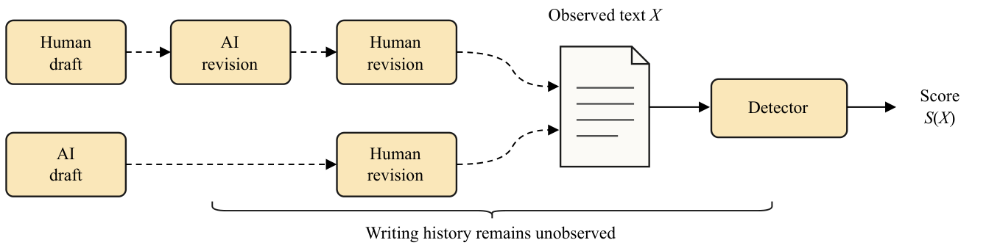
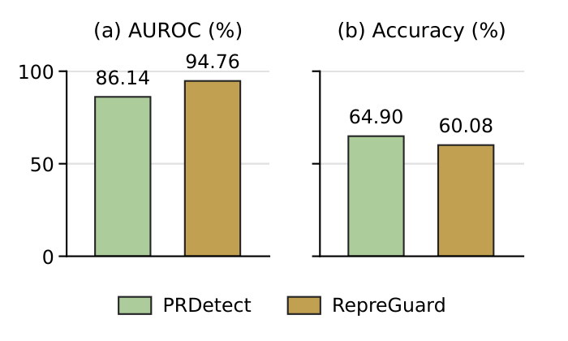
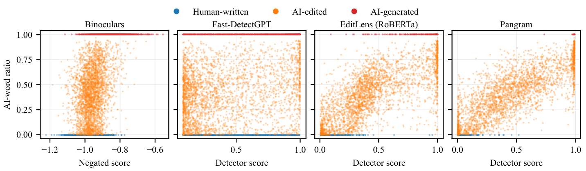
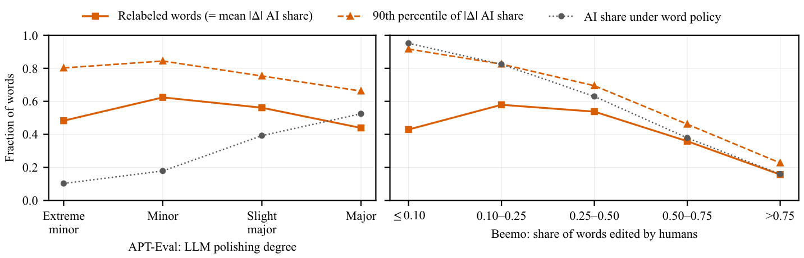
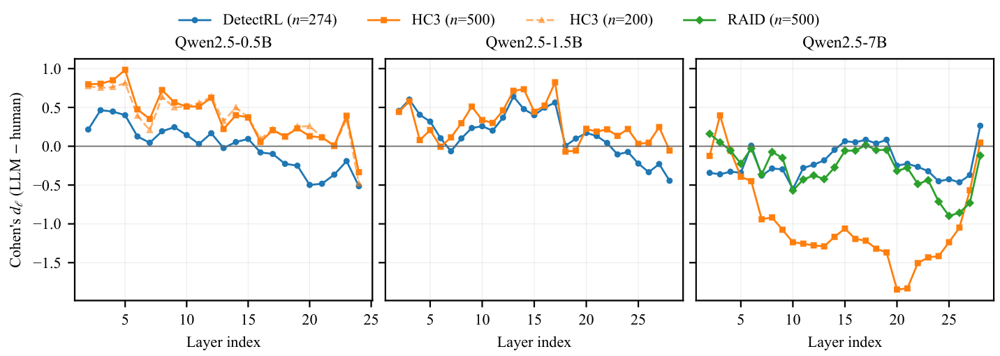
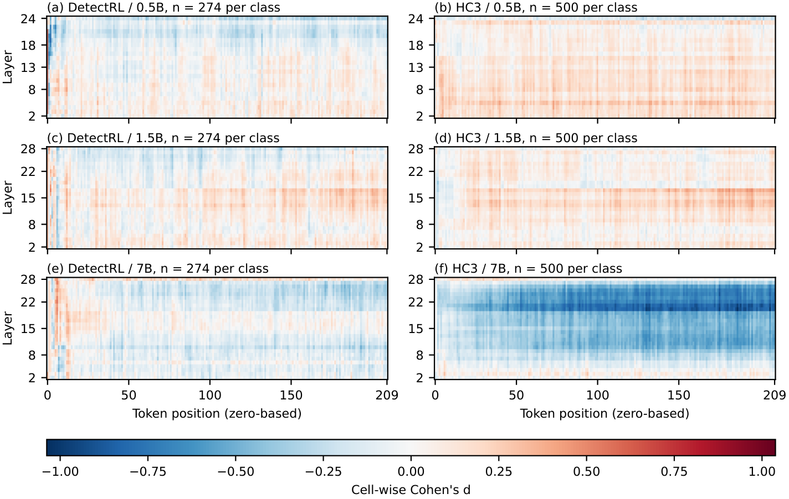
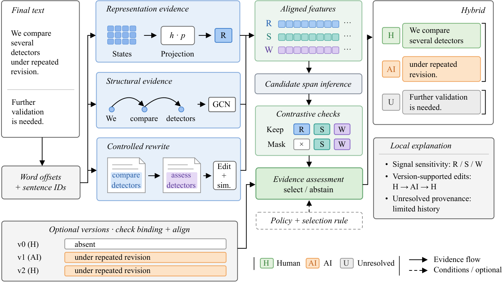

<div align="center">

# Beyond Human vs AI

### A Survey of Attribution, Robustness, and Human–AI Co-authorship in Large Language Model Forensics

Pham Quang Toan · Nguyen Duc Trung · Hoang Chi Hien · Nguyen Quang Chien · Nguyen Kieu Linh

Posts and Telecommunications Institute of Technology, Ha Noi, Vietnam<br>
Corresponding author: [Nguyen Kieu Linh](mailto:linhnk@ptit.edu.vn)

[](#paper-list)
[](#taxonomy-at-a-glance)
[](#shared-tasks-7)
[](#main-results)
[](docs/figure-gallery.md)
[](LICENSE)
[](https://github.com/pitorr05/BeyondHuAI/actions/workflows/validate.yml)

</div>

## Overview

Detectors of text generated by large language models (LLMs) separate human and machine documents well under controlled conditions, but a document-level score cannot show where or how AI contributed to an edited or co-authored text. This survey examines that gap between detection performance and authorship evidence. It organizes detection methods by mechanism, model access and development requirements, maps **21 benchmarks** and **7 shared tasks** to the forensic capabilities they test, and complements the synthesis with **four empirical analyses**: a five-detector comparison, a cross-benchmark study of ranking and decisions, a reanalysis of graded AI contribution, and activation diagnostics on eight Qwen2.5 configurations. From these results it derives **PAAR**, a reference architecture that links local contribution estimates to contrastive evidence checks, recorded editing roles, uncertainty estimates and claim-specific review.

<p align="center">
  <br>
  <em>Fig. 1. Several writing histories can produce the same final text; a document-level detector observes only the final artifact.</em>
</p>

This repository accompanies the survey with the literature catalog, evaluation splits, result tables, representation records, analysis code and all manuscript figures.

## Contents

- [Highlights](#highlights)
- [Taxonomy at a glance](#taxonomy-at-a-glance)
- [Main results](#main-results)
- [PAAR reference architecture](#paar-reference-architecture)
- [Paper list](#paper-list)
- [Repository structure](#repository-structure)
- [Reproducing the results](#reproducing-the-results)
- [Citation](#citation)

## Highlights

| | Finding | Evidence |
|---|---|---|
| 1 | **Good ranking can coexist with poor decisions.** With decision rules fixed on HC3, RepreGuard reaches 94.76% AUROC on GPT-3.5 mixed but only 60.08% accuracy, below PRDetect (86.14% AUROC, 64.90% accuracy). | Table 9, Fig. 2 |
| 2 | **Rankings depend on the test distribution.** PRDetect leads in-domain (AUROC 99.73% on HC3, 99.77% on DetectRL), while RepreGuard leads all four external test sets in AUROC by 4.81–10.03 points. | Tables 8–9 |
| 3 | **A document score is a weak proxy for graded AI contribution.** On 2,925 AI-edited EditLens documents, zero-shot scores reach Spearman ρ ≈ 0.21 with the share of AI-written words; trained detectors reach 0.74–0.80, and one score decile still spans an AI-share range of 0.38–0.66. | Table 10, Fig. 4 |
| 4 | **"How much AI" depends on the attribution policy.** Switching from word- to sentence-level attribution relabels 48.3% of the words in extreme-minor polishing and 62.4% in minor polishing on APT-Eval. | Fig. 3 |
| 5 | **Contrast magnitude and portability diverge inside the model.** HC3/7B shows the largest layer effect (d = −1.846) but the weakest profile agreement with DetectRL (r = 0.019); the peak layer moves from 20 (HC3) to 10 (DetectRL) and 25 (RAID) on the same backbone. | Tables 11–12, Figs. 5–6 |

<p align="center">
  <br>
  <em>Fig. 2. Ranking–decision divergence on GPT-3.5 mixed.</em>
</p>

## Taxonomy at a glance

Methods are organized by mechanism and by the resources needed to develop and apply them (Table 2 of the survey). P: token probabilities or ranks; H: hidden states; Q: generation or rewriting calls beyond probability scoring; L: task-specific fitted components or reference statistics; V: watermark verification.

<details open>
<summary><b>All 31 methods in Table 2</b></summary>

| Branch | Method | Main signal | P | H | Q | L | V | Evaluation focus |
|---|---|---|:-:|:-:|:-:|:-:|:-:|---|
| Zero-shot | DetectGPT | Curvature | ✓ |  | ✓ |  |  | Source, model |
| Zero-shot | Fast-DetectGPT | Conditional curv. | ✓ |  |  |  |  | Detection, cost |
| Zero-shot | DetectLLM | Likelihood/rank | ✓ |  | ✓ |  |  | Accuracy, cost |
| Zero-shot | Binoculars | Contrastive score | ✓ |  |  |  |  | Low false-positive rate |
| Zero-shot | Telescope | Token repetition | ✓ |  |  |  |  | Cross-setting |
| Zero-shot | NTS | Temperature | ✓ |  |  |  |  | Source, domain |
| Zero-shot | Exons-Detect | State reweighting | ✓ | ✓ |  |  |  | Edit, length |
| Zero-shot | GECScore | Correction score |  |  | ✓ |  |  | Source via correction |
| Zero-shot | DNA-GPT | Continuation | ✓ |  | ✓ |  |  | Cross-source |
| Zero-shot | TOCSIN | Token cohesion | ✓ |  |  |  |  | Base-score gain |
| Zero-shot | Glimpse | Estimated distribution | ✓ |  | ✓ |  |  | Proprietary models |
| Zero-shot | Revise-Detect | Revision similarity |  |  | ✓ |  |  | Black-box query |
| Training-based | RepreGuard | Probe directions |  | ✓ |  | ✓ |  | ID, OOD |
| Training-based | Text Fluoroscopy | Layer features |  | ✓ |  | ✓ |  | Cross-domain |
| Training-based | PRDetect | Syntax |  |  |  | ✓ |  | Perturb., transfer |
| Training-based | Raidar | Rewrite distance |  |  | ✓ | ✓ |  | Source via rewrite |
| Training-based | StyleDecipher | Rewrite/style |  |  | ✓ | ✓ |  | Domain, mixed text |
| Training-based | SenDetEX | Style + context |  |  |  | ✓ |  | Hybrid text |
| Training-based | DeTeCtive | Contrastive style |  |  |  | ✓ |  | OOD, new sources |
| Training-based | RADAR | Adversarial |  |  |  | ✓ |  | Paraphrase |
| Training-based | Learning2Rewrite | Learned rewrite |  |  | ✓ | ✓ |  | Domain, attacks |
| Training-based | Ghostbuster | LM features | ✓ |  |  | ✓ |  | Source, domain |
| Training-based | MoSEs | Style features |  |  |  | ✓ |  | Low-resource |
| Training-based | SENTRA | Probability seq. | ✓ |  |  | ✓ |  | OOD |
| Training-based | WaveDetect | Wavelet features | ✓ |  |  | ✓ |  | Attack, shift |
| Watermarking | Kirchenbauer et al. | Token bias |  |  |  |  | ✓ | Detectability |
| Watermarking | Adaptive watermark | Adaptive signal |  |  |  |  | ✓ | Quality, security |
| Watermarking | RL watermarking | Learned signal |  |  |  |  | ✓ | Removal, spoofing |
| Watermarking | StealthInk | Multi-bit signal |  |  |  |  | ✓ | Payload, stealth |
| Watermarking | Unigram | Fixed green list |  |  |  |  | ✓ | Edit robustness |
| Watermarking | SynthID-Text | Tournament sampling |  |  |  |  | ✓ | Deployment, quality |

DNA-GPT's P requirement applies to its white-box variant.

</details>

The benchmark synthesis maps each benchmark to adversarial attacks, human editing, unseen models, source attribution, fine-grained labels, low-FPR evaluation and per-language reporting (Table 6), and the shared-task review covers ALTA 2023, AuTexTification 2023, CLIN33 2024, SemEval-2024 Task 8, DagPap24, GenAI Detection Task 1 and PAN 2025 (Table 7).

## Main results

### Five-detector comparison on DetectRL and HC3 (Table 8)

| Detector (backbone) | DetectRL AUROC | Prec | Rec | F1 | HC3 AUROC | Prec | Rec | F1 |
|---|---:|---:|---:|---:|---:|---:|---:|---:|
| RepreGuard (Qwen2.5-0.5B-Instruct) | 96.04 | **99.95** | 81.56 | 89.82 | 95.95 | 94.42 | 96.50 | 95.45 |
| StyleDecipher (GPT-OSS-20B) | 82.81 | 74.96 | 72.37 | 73.64 | 90.05 | 74.75 | 71.56 | 73.12 |
| Binoculars (GPT-Neo-2.7B) | 95.09 | 99.48 | 77.20 | 86.94 | 99.22 | 94.29 | **99.00** | 96.59 |
| Fast-DetectGPT (GPT-Neo-2.7B) | 89.47 | 85.56 | 80.60 | 83.01 | 98.98 | 91.79 | 98.40 | 94.98 |
| PRDetect (RoBERTa-base) | **99.77** | 97.75 | **97.94** | **97.84** | **99.73** | **98.79** | 98.00 | **98.39** |

All values in %. Each benchmark uses a 2,000-sample training split and a 1,000-sample test split. [CSV](results/detectors/five-detector-comparison.csv)

### Cross-benchmark ranking and decisions (Table 9)

| Test set | PRDetect Acc | AUROC | F1 | RepreGuard Acc | AUROC | F1 |
|---|---:|---:|---:|---:|---:|---:|
| HC3 (in-domain) | **97.40** | **99.60** | **97.46** | 95.40 | 95.95 | 95.45 |
| GPT-3.5 mixed | **64.90** | 86.14 | **73.47** | 60.08 | **94.76** | 71.84 |
| RAID Llama greedy | 74.40 | 88.75 | 78.36 | **83.60** | **98.29** | **85.70** |
| RAID Llama sampling | 73.05 | 87.43 | 77.48 | **83.35** | **97.46** | **85.45** |
| RAID Mistral | 78.10 | 90.08 | 80.89 | **81.45** | **94.89** | **83.52** |

Decision rules are fixed on HC3 (RepreGuard τ = −5.76) and applied unchanged to the external sets. RepreGuard's ROC-interpolated TPR at 0.01% FPR is 62.7% on HC3 and 8.1–19.9% on the external sets. [CSV](results/detectors/cross-benchmark-comparison.csv)

### Document scores and graded AI contribution (Table 10)

| Detector | ρ all (8,515 docs) | ρ AI-edited (2,925 docs) | AI-share spread within a score decile |
|---|---:|---:|---:|
| Binoculars | 0.675 | 0.216 | 0.655 |
| Fast-DetectGPT | 0.687 | 0.205 | 0.658 |
| EditLens (RoBERTa) | 0.931 | 0.737 | 0.415 |
| Pangram | 0.942 | 0.798 | 0.375 |

[CSV](results/contribution/score_vs_ai_ratio.csv)

<p align="center">
  <br>
  <em>Fig. 4. Detector score versus word-level AI ratio for 8,515 EditLens documents.</em>
</p>

### Attribution policy changes the measured AI share (Fig. 3)

| Corpus | Level | Docs | AI share (word policy) | Words relabeled by sentence policy |
|---|---|---:|---:|---:|
| APT-Eval | extreme-minor | 1,368 | 10.3% | 48.3% |
| APT-Eval | minor | 1,348 | 17.9% | 62.4% |
| APT-Eval | slight-major | 1,310 | 39.2% | 56.1% |
| APT-Eval | major | 1,119 | 52.5% | 43.9% |
| Beemo | 10–25% human-edited | 424 | 82.4% | 57.9% |
| Beemo | > 75% human-edited | 267 | 15.9% | 15.7% |

[CSV with all levels](results/contribution/policy_disagreement.csv)

<p align="center">
  <br>
  <em>Fig. 3. Word-level versus sentence-level attribution on APT-Eval and Beemo.</em>
</p>

### Representation diagnostics on eight Qwen2.5 configurations (Tables 11–12)

| Configuration | Peak layer | Cohen's d | Layers with CI excluding 0 | Cells with \|d\| ≥ 0.5 |
|---|---:|---:|---:|---:|
| DetectRL / 0.5B (n = 274) | 24 | −0.515 | 13/23 | 0.79% |
| DetectRL / 1.5B (n = 274) | 13 | +0.641 | 18/27 | 0.02% |
| DetectRL / 7B (n = 274) | 10 | −0.550 | 20/27 | 0.12% |
| HC3 / 0.5B (n = 500) | 5 | +0.984 | 21/23 | 0.00% |
| HC3 / 1.5B (n = 500) | 17 | +0.825 | 19/27 | 0.00% |
| HC3 / 7B (n = 500) | 20 | −1.846 | 25/27 | 29.77% |
| RAID / 7B (n = 500) | 25 | −0.897 | 17/27 | 0.65% |

Cross-corpus profile alignment (Pearson r) for HC3–DetectRL is 0.901, 0.779 and 0.019 at 0.5B, 1.5B and 7B; DetectRL–RAID at 7B reaches 0.585. All 204 layer records and 42,840 layer–position records are released in [results/representation/summaries](results/representation/summaries/).

<p align="center">
  <br>
  <em>Fig. 5. Layer-wise Cohen's d for document-pooled signed activations.</em>
</p>

<p align="center">
  <br>
  <em>Fig. 6. Cell-wise standardized contrasts for DetectRL (left) and HC3 (right) with three backbones.</em>
</p>

## PAAR reference architecture

Process-Aware Authorship Reconstruction (PAAR) predicts policy-defined word-level contributions (Human, AI or unresolved) from three word-aligned evidence channels: representation (R, following RepreGuard), structure (S, following PRDetect) and rewrite response (W, following StyleDecipher). Candidate spans are decoded with an MLP–CRF, checked by masking one channel at a time, combined with available version records, and assessed as *supported within stated conditions*, *contradicted by relevant evidence* or *insufficient evidence*.

<p align="center">
  <br>
  <em>Fig. 7. PAAR reference architecture.</em>
</p>

| | Testable requirement | Primary assessment |
|---|---|---|
| H1 | Contribution-aware evidence | Span/word F1 and policy-specific contribution error |
| H2 | Transformation-aware evidence | Prediction stability at matched operating constraints |
| H3 | Open-world evaluation | Ranking and realized FPR/TPR on generator-disjoint and temporal splits |
| H4 | Selective decisions under shift | Risk–coverage and error control |
| H5 | Conditional reliability across writer groups | Group-conditional FPR/TPR |
| H6 | Complementary record evidence | Incremental claim-assessment utility |

All figures are collected in the [figure gallery](docs/figure-gallery.md).

## Paper list

The survey cites **112 works**, 108 of them published or released between January 2023 and September 2026. [survey/catalog.csv](survey/catalog.csv) records the role, method family and topics of each work, and [survey/references.bib](survey/references.bib) holds the full BibTeX.

### Detection methods (43)

#### Zero-shot (18)

| Paper | Venue | Year | Resources |
|---|---|---:|---|
| Exons-Detect: Identifying and Amplifying Exonic Tokens via Hidden-State Discrepancy for Robust AI-Generated Text Detection | ACL | 2026 | [Paper](https://aclanthology.org/2026.acl-long.1211/) |
| Telescope: Improving Zero-Shot Detection of LLM Generated Content By Measuring Token Repetition Probability | arXiv | 2026 | [Paper](https://arxiv.org/abs/2607.04061v1) |
| Zero-Shot Detection of LLM-Generated Text using Temperature Sensitivity | ACL | 2026 | [Paper](https://aclanthology.org/2026.acl-long.1748/) |
| DivScore: Zero-Shot Detection of LLM-Generated Text in Specialized Domains | EMNLP | 2025 | [Paper](https://aclanthology.org/2025.emnlp-main.971/) |
| Glimpse: Enabling White-Box Methods to Use Proprietary Models for Zero-Shot LLM-Generated Text Detection | ICLR | 2025 | [BibTeX](survey/references.bib) |
| Training-Free LLM-Generated Text Detection by Mining Token Probability Sequences | ICLR | 2025 | [BibTeX](survey/references.bib) |
| Who Wrote This? The Key to Zero-Shot LLM-Generated Text Detection Is GECScore | COLING | 2025 | [Paper](https://aclanthology.org/2025.coling-main.684/) · [Code](https://github.com/NLP2CT/GECScore) |
| DNA-GPT: Divergent N-Gram Analysis for Training-Free Detection of GPT-Generated Text | ICLR | 2024 | [Paper](https://openreview.net/forum?id=Xlayxj2fWp) · [Code](https://github.com/Xianjun-Yang/DNA-GPT) |
| Fast-DetectGPT: Efficient Zero-Shot Detection of Machine-Generated Text via Conditional Probability Curvature | ICLR | 2024 | [Paper](https://openreview.net/forum?id=Bpcgcr8E8Z) · [Code](https://github.com/baoguangsheng/fast-detect-gpt) |
| OUTFOX: LLM-Generated Essay Detection Through In-Context Learning with Adversarially Generated Examples | AAAI | 2024 | [Paper](https://doi.org/10.1609/aaai.v38i19.30120) |
| Spotting LLMs With Binoculars: Zero-Shot Detection of Machine-Generated Text | ICML | 2024 | [Paper](https://proceedings.mlr.press/v235/hans24a.html) · [Code](https://github.com/ahans30/Binoculars) |
| Zero-Shot Detection of LLM-Generated Text using Token Cohesiveness | EMNLP | 2024 | [Paper](https://aclanthology.org/2024.emnlp-main.971/) |
| Beat LLMs at Their Own Game: Zero-Shot LLM-Generated Text Detection via Querying ChatGPT | EMNLP | 2023 | [Paper](https://aclanthology.org/2023.emnlp-main.463/) |
| DetectGPT: Zero-Shot Machine-Generated Text Detection Using Probability Curvature | ICML | 2023 | [Paper](https://proceedings.mlr.press/v202/mitchell23a.html) · [Code](https://github.com/eric-mitchell/detect-gpt) |
| DetectLLM: Leveraging Log Rank Information for Zero-Shot Detection of Machine-Generated Text | Findings EMNLP | 2023 | [Paper](https://aclanthology.org/2023.findings-emnlp.827/) |
| Fighting Fire with Fire: Can ChatGPT Detect AI-Generated Text? | SIGKDD Explorations | 2023 | [Paper](https://doi.org/10.1145/3655103.3655106) |
| Intrinsic Dimension Estimation for Robust Detection of AI-Generated Texts | NeurIPS | 2023 | [BibTeX](survey/references.bib) |
| GLTR: Statistical Detection and Visualization of Generated Text | ACL Demo | 2019 | [Paper](https://aclanthology.org/P19-3019/) |

#### Training-based (16)

| Paper | Venue | Year | Resources |
|---|---|---:|---|
| WaveDetect: Robust Framework for Machine-Generated Text Detection via Wavelet Transform | Findings ACL | 2026 | [Paper](https://aclanthology.org/2026.findings-acl.424/) |
| Learning to Rewrite: Generalized LLM-Generated Text Detection | ACL | 2025 | [Paper](https://aclanthology.org/2025.acl-long.322/) |
| MoSEs: Uncertainty-Aware AI-Generated Text Detection via Mixture of Stylistics Experts with Conditional Thresholds | EMNLP | 2025 | [Paper](https://aclanthology.org/2025.emnlp-main.294/) |
| PRDetect: Perturbation-Robust LLM-generated Text Detection Based on Syntax Tree | Findings NAACL | 2025 | [Paper](https://aclanthology.org/2025.findings-naacl.464/) · [Code](https://github.com/thulx18/PRDetect) |
| RepreGuard: Detecting LLM-Generated Text by Revealing Hidden Representation Patterns | TACL | 2025 | [Paper](https://aclanthology.org/2025.tacl-1.81/) · [Code](https://github.com/NLP2CT/RepreGuard) |
| SENTRA: Selected-Next-Token Transformer for LLM Text Detection | Findings EMNLP | 2025 | [Paper](https://aclanthology.org/2025.findings-emnlp.1004/) |
| SenDetEX: Sentence-Level AI-Generated Text Detection for Human-AI Hybrid Content via Style and Context Fusion | EMNLP | 2025 | [Paper](https://aclanthology.org/2025.emnlp-main.268/) |
| StyleDecipher: Robust and Explainable Detection of LLM-Generated Texts with Stylistic Analysis | arXiv | 2025 | [Paper](https://arxiv.org/abs/2510.12608) · [Code](https://github.com/SiyuanLi00/StyleDecipher) |
| DeTeCtive: Detecting AI-Generated Text via Multi-Level Contrastive Learning | NeurIPS | 2024 | [BibTeX](survey/references.bib) |
| Ghostbuster: Detecting Text Ghostwritten by Large Language Models | NAACL | 2024 | [Paper](https://aclanthology.org/2024.naacl-long.95/) |
| Raidar: geneRative AI Detection viA Rewriting | ICLR | 2024 | [Paper](https://openreview.net/forum?id=bQWE2UqXmf) |
| Technical Report on the Pangram AI-Generated Text Classifier | arXiv | 2024 | [Paper](https://arxiv.org/abs/2402.14873) |
| Text Fluoroscopy: Detecting LLM-Generated Text through Intrinsic Features | EMNLP | 2024 | [Paper](https://aclanthology.org/2024.emnlp-main.885/) |
| CoCo: Coherence-Enhanced Machine-Generated Text Detection Under Low Resource with Contrastive Learning | EMNLP | 2023 | [Paper](https://doi.org/10.18653/v1/2023.emnlp-main.1005) |
| Neural Authorship Attribution: Stylometric Analysis on Large Language Models | CyberC | 2023 | [Paper](https://doi.org/10.1109/CyberC58899.2023.00019) |
| RADAR: Robust AI-Text Detection via Adversarial Learning | NeurIPS | 2023 | [Paper](https://proceedings.neurips.cc/paper_files/paper/2023/hash/30e15e5941ae0cdab7ef58cc8d59a4ca-Abstract-Conference.html) |

#### Watermarking (9)

| Paper | Venue | Year | Resources |
|---|---|---:|---|
| A Reinforcement Learning Framework for Robust and Secure LLM Watermarking | EACL | 2026 | [Paper](https://aclanthology.org/2026.eacl-long.338/) |
| StealthInk: A Multi-bit and Stealthy Watermark for Large Language Models | ICML | 2025 | [Paper](https://proceedings.mlr.press/v267/jiang25j.html) |
| Adaptive Text Watermark for Large Language Models | ICML | 2024 | [Paper](https://proceedings.mlr.press/v235/liu24e.html) |
| Provable Robust Watermarking for AI-Generated Text | ICLR | 2024 | [BibTeX](survey/references.bib) |
| Robust Distortion-Free Watermarks for Language Models | TMLR | 2024 | [BibTeX](survey/references.bib) |
| Scalable Watermarking for Identifying Large Language Model Outputs | Nature | 2024 | [Paper](https://doi.org/10.1038/s41586-024-08025-4) |
| SemStamp: A Semantic Watermark with Paraphrastic Robustness for Text Generation | NAACL | 2024 | [Paper](https://aclanthology.org/2024.naacl-long.226/) |
| Undetectable Watermarks for Language Models | COLT | 2024 | [BibTeX](survey/references.bib) |
| A Watermark for Large Language Models | ICML | 2023 | [Paper](https://proceedings.mlr.press/v202/kirchenbauer23a.html) · [Code](https://github.com/jwkirchenbauer/lm-watermarking) |

### Benchmarks and datasets (20)

| Paper | Venue | Year | Resources |
|---|---|---:|---|
| DetectRL-X: Towards Reliable Multilingual and Real-World LLM-Generated Text Detection | Proceedings of the 64th Annual Meeting o | 2026 | [Paper](https://aclanthology.org/2026.acl-long.1773/) |
| Operation-Guided Progressive Human-to-AI Text Transformation Benchmark for Multi-Granularity AI-Text Detection | arXiv | 2026 | [Paper](https://arxiv.org/abs/2606.06481v1) |
| Almost AI, Almost Human: The Challenge of Detecting AI-Polished Writing | Findings ACL | 2025 | [BibTeX](survey/references.bib) |
| Beemo: Benchmark of Expert-edited Machine-generated Outputs | Proceedings of the 2025 Conference of th | 2025 | [Paper](https://aclanthology.org/2025.naacl-long.357/) |
| Decoupling Content and Expression: Two-Dimensional Detection of AI-Generated Text | arXiv preprint arXiv:2503.00258 | 2025 | [Paper](https://arxiv.org/abs/2503.00258) |
| EvoBench: Towards Real-world LLM-Generated Text Detection Benchmarking for Evolving Large Language Models | Findings of the Association for Computat | 2025 | [Paper](https://aclanthology.org/2025.findings-acl.754/) |
| HACo-Det: A Study Towards Fine-Grained Machine-Generated Text Detection under Human-AI Coauthoring | Proceedings of the 63rd Annual Meeting o | 2025 | [Paper](https://aclanthology.org/2025.acl-long.1069/) |
| Mark My Words: Analyzing and Evaluating Language Model Watermarks | SaTML | 2025 | [Paper](https://doi.org/10.1109/SaTML64287.2025.00012) |
| MultiSocial: Multilingual Benchmark of Machine-Generated Text Detection of Social-Media Texts | Proceedings of the 63rd Annual Meeting o | 2025 | [Paper](https://aclanthology.org/2025.acl-long.36/) |
| OpenTuringBench: An Open-Model-based Benchmark and Framework for Machine-Generated Text Detection and Attribution | Proceedings of the 2025 Conference on Em | 2025 | [Paper](https://aclanthology.org/2025.emnlp-main.1354/) |
| WETBench: A Benchmark for Detecting Task-Specific Machine-Generated Text on Wikipedia | Proceedings of the 2nd Workshop on Advan | 2025 | [Paper](https://aclanthology.org/2025.wikinlp-1.6/) |
| DetectRL: Benchmarking LLM-Generated Text Detection in Real-World Scenarios | Advances in Neural Information Processin | 2024 | [Paper](https://doi.org/10.52202/079017-3186) · [Code](https://github.com/NLP2CT/DetectRL) |
| M4: Multi-generator, Multi-domain, and Multi-lingual Black-Box Machine-Generated Text Detection | Proceedings of the 18th Conference of th | 2024 | [Paper](https://aclanthology.org/2024.eacl-long.83/) |
| M4GT-Bench: Evaluation Benchmark for Black-Box Machine-Generated Text Detection | Proceedings of the 62nd Annual Meeting o | 2024 | [Paper](https://aclanthology.org/2024.acl-long.218/) |
| MAGE: Machine-generated Text Detection in the Wild | Proceedings of the 62nd Annual Meeting o | 2024 | [Paper](https://aclanthology.org/2024.acl-long.3/) |
| MGTBench: Benchmarking Machine-Generated Text Detection | Proceedings of the 2024 ACM SIGSAC Confe | 2024 | [Paper](https://doi.org/10.1145/3658644.3670344) |
| On the Detectability of ChatGPT Content: Benchmarking, Methodology, and Evaluation Through the Lens of Academic Writing | Proceedings of the 2024 ACM SIGSAC Confe | 2024 | [Paper](https://www.ittc.ku.edu/~bluo/pubs/liu2024checkgpt.pdf) |
| RAID: A Shared Benchmark for Robust Evaluation of Machine-Generated Text Detectors | Proceedings of the 62nd Annual Meeting o | 2024 | [Paper](https://aclanthology.org/2024.acl-long.674/) · [Code](https://github.com/liamdugan/raid) |
| How Close is ChatGPT to Human Experts? Comparison Corpus, Evaluation, and Detection | arXiv preprint arXiv:2301.07597 | 2023 | [Paper](https://arxiv.org/abs/2301.07597) |
| MULTITuDE: Large-Scale Multilingual Machine-Generated Text Detection Benchmark | Proceedings of the 2023 Conference on Em | 2023 | [Paper](https://aclanthology.org/2023.emnlp-main.616/) |

### Fine-grained authorship and human–AI collaboration (7)

| Paper | Venue | Year | Resources |
|---|---|---:|---|
| CoCoNUTS: Concentrating on Content while Neglecting Uninformative Textual Styles for AI-Generated Peer Review Detection | ACL | 2026 | [Paper](https://aclanthology.org/2026.acl-long.1240/) |
| Detecting LLM-Generated Tokens in Human--LLM Coauthored Text | arXiv preprint arXiv:2607.21458 | 2026 | [Paper](https://arxiv.org/abs/2607.21458v1) |
| EditLens: Quantifying the Extent of AI Editing in Text | ICLR | 2026 | [BibTeX](survey/references.bib) |
| SenFlow: Inter-Sentence Flow Modeling for AI-Generated Text Detection in Hybrid Documents | arXiv | 2026 | [Paper](https://arxiv.org/abs/2606.18946v1) |
| LLM-as-a-Coauthor: Can Mixed Human-Written and Machine-Generated Text Be Detected? | Findings NAACL | 2024 | [Paper](https://aclanthology.org/2024.findings-naacl.29/) |
| Spotting AI's Touch: Identifying LLM-Paraphrased Spans in Text | Findings ACL | 2024 | [Paper](https://aclanthology.org/2024.findings-acl.423/) |
| SeqXGPT: Sentence-Level AI-Generated Text Detection | EMNLP | 2023 | [Paper](https://aclanthology.org/2023.emnlp-main.73/) |

### Robustness and attacks (3)

| Paper | Venue | Year | Resources |
|---|---|---:|---|
| Revealing Weaknesses in Text Watermarking Through Self-Information Rewrite Attacks | ICML | 2025 | [Paper](https://proceedings.mlr.press/v267/cheng25c.html) |
| Stumbling Blocks: Stress Testing the Robustness of Machine-Generated Text Detectors Under Attacks | ACL | 2024 | [Paper](https://aclanthology.org/2024.acl-long.160/) |
| Paraphrasing Evades Detectors of AI-Generated Text, But Retrieval is an Effective Defense | NeurIPS | 2023 | [Paper](https://proceedings.neurips.cc/paper_files/paper/2023/hash/575c450013d0e99e4b0ecf82bd1afaa4-Abstract-Conference.html) |

### Reliability, explanation and verification (10)

| Paper | Venue | Year | Resources |
|---|---|---:|---|
| ExaGPT: Example-Based Machine-Generated Text Detection for Human Interpretability | Findings ACL | 2026 | [Paper](https://aclanthology.org/2026.findings-acl.380/) |
| Show, Don't TELL: Explainable AI-Generated Text Detection | arXiv | 2026 | [Paper](https://arxiv.org/abs/2605.27921v1) |
| Reliably Bounding False Positives: A Zero-Shot Machine-Generated Text Detection Framework via Multiscaled Conformal Prediction | ACL | 2025 | [Paper](https://aclanthology.org/2025.acl-long.601/) |
| The Two Paradigms of LLM Detection: Authorship Attribution vs. Authorship Verification | Findings ACL | 2025 | [Paper](https://aclanthology.org/2025.findings-acl.194/) |
| Who Writes What: Unveiling the Impact of Author Roles on AI-generated Text Detection | ACL | 2025 | [Paper](https://aclanthology.org/2025.acl-long.1292/) |
| Can AI-Generated Text Be Reliably Detected? | arXiv | 2023 | [Paper](https://arxiv.org/abs/2303.11156) |
| GPT Detectors are Biased Against Non-Native English Writers | Patterns | 2023 | [Paper](https://doi.org/10.1016/j.patter.2023.100779) |
| On the Possibilities of AI-Generated Text Detection | arXiv | 2023 | [Paper](https://arxiv.org/abs/2304.04736) |
| Testing of Detection Tools for AI-Generated Text | Int. J. Educational Integrity | 2023 | [Paper](https://doi.org/10.1007/s40979-023-00146-z) |
| All That's `Human' Is Not Gold: Evaluating Human Evaluation of Generated Text | ACL | 2021 | [Paper](https://aclanthology.org/2021.acl-long.565/) |

### Shared tasks (7)

| Paper | Venue | Year | Resources |
|---|---|---:|---|
| GenAI Content Detection Task 1: English and Multilingual Machine-Generated Text Detection: AI vs. Human | GenAI Detection Workshop | 2025 | [BibTeX](survey/references.bib) |
| Overview of PAN 2025: Generative AI Detection, Multilingual Text Detoxification, Multi-Author Writing Style Analysis, and Generative Plagiarism Detection | ECIR | 2025 | [BibTeX](survey/references.bib) |
| Overview of the DagPap24 Shared Task on Detecting Automatically Generated Scientific Paper | SDP Workshop | 2024 | [BibTeX](survey/references.bib) |
| SemEval-2024 Task 8: Multidomain, Multimodel and Multilingual Machine-Generated Text Detection | SemEval | 2024 | [Paper](https://aclanthology.org/2024.semeval-1.279/) |
| The CLIN33 Shared Task on the Detection of Text Generated by Large Language Models | CLIN Journal | 2024 | [BibTeX](survey/references.bib) |
| Overview of AuTexTification at IberLEF 2023: Detection and Attribution of Machine-Generated Text in Multiple Domains | IberLEF | 2023 | [BibTeX](survey/references.bib) |
| Overview of the 2023 ALTA Shared Task: Discriminate Between Human-Written and Machine-Generated Text | ALTA | 2023 | [BibTeX](survey/references.bib) |

### Related surveys (12)

| Paper | Venue | Year | Resources |
|---|---|---:|---|
| Human or Machine? A Survey on Machine-Generated Text Detection | IEEE Access | 2026 | [Paper](https://doi.org/10.1109/ACCESS.2026.3666781) |
| What Distinguishes AI-Generated from Human Writing? A Rapid Review of the Literature | Big Data and Cognitive Computing | 2026 | [Paper](https://doi.org/10.3390/bdcc10020055) |
| A Comprehensive Survey of Fake Text Detection on Misinformation and LM-Generated Texts | IEEE Access | 2025 | [Paper](https://doi.org/10.1109/ACCESS.2025.3538805) |
| A Survey of AI-Generated Content (AIGC) | ACM CSUR | 2025 | [Paper](https://doi.org/10.1145/3704262) |
| A Survey of Text Watermarking in the Era of Large Language Models | ACM CSUR | 2025 | [Paper](https://doi.org/10.1145/3691626) |
| A Survey on LLM-Generated Text Detection: Necessity, Methods, and Future Directions | Computational Linguistics | 2025 | [Paper](https://aclanthology.org/2025.cl-1.8/) |
| AI-generated text detection: A comprehensive review of methods, datasets, and applications | Computer Science Review | 2025 | [Paper](https://www.sciencedirect.com/science/article/pii/S1574013725000693) |
| The Imitation Game revisited: A comprehensive survey on recent advances in AI-generated text detection | ESWA | 2025 | [Paper](https://www.sciencedirect.com/science/article/pii/S0957417425003161) |
| A Survey of AI-generated Text Forensic Systems: Detection, Attribution, and Characterization | arXiv | 2024 | [Paper](https://arxiv.org/abs/2403.01152) |
| A Survey on Detection of LLMs-Generated Content | Findings EMNLP | 2024 | [Paper](https://aclanthology.org/2024.findings-emnlp.572/) |
| Machine-Generated Text: A Comprehensive Survey of Threat Models and Detection Methods | IEEE Access | 2023 | [Paper](https://doi.org/10.1109/ACCESS.2023.3294090) |
| Automatic Detection of Machine Generated Text: A Critical Survey | COLING | 2020 | [Paper](https://aclanthology.org/2020.coling-main.208/) |

### Foundations and applications (10)

| Paper | Venue | Year | Resources |
|---|---|---:|---|
| LLMs for Science: Usage for Code Generation and Data Analysis | Journal of Software: Evolution and Process | 2025 | [Paper](https://doi.org/10.1002/smr.2723) |
| Qwen2.5 Technical Report | arXiv | 2025 | [Paper](https://arxiv.org/abs/2412.15115v2) |
| Collaborating With ChatGPT: Considering the Implications of Generative Artificial Intelligence for Journalism and Media Education | Journalism & Mass Communication Educator | 2023 | [Paper](https://doi.org/10.1177/10776958221149577) |
| ChatGPT in Medicine: Prospects and Challenges: A Review Article | International Journal of Surgery | 2024 | [Paper](https://doi.org/10.1097/JS9.0000000000001312) |
| The Role of ChatGPT in Medical Research: Progress and Limitations | Annals of Biomedical Engineering | 2024 | [Paper](https://doi.org/10.1007/s10439-023-03311-0) |
| Experimental Evidence on the Productivity Effects of Generative Artificial Intelligence | Science | 2023 | [Paper](https://doi.org/10.1126/science.adh2586) |
| GPT-4 Technical Report | arXiv | 2023 | [Paper](https://arxiv.org/abs/2303.08774) |
| LLaMA: Open and Efficient Foundation Language Models | arXiv | 2023 | [Paper](https://arxiv.org/abs/2302.13971) |
| Regulating ChatGPT and Other Large Generative AI Models | ACM FAccT | 2023 | [Paper](https://doi.org/10.1145/3593013.3594067) |
| On the Opportunities and Risks of Foundation Models | arXiv | 2021 | [Paper](https://arxiv.org/abs/2108.07258) |

## Repository structure

```
BeyondHuAI/
├── analysis/            # representation extraction, statistics, plotting and table rebuild
├── assets/
│   ├── paper/           # manuscript figures (PNG/PDF originals)
│   ├── previews/        # 200-dpi PNG previews of PDF figures
│   └── manifest.json    # figure index with SHA-256 checksums
├── configs/representation/   # eight run configurations (seed 42, 1,000 bootstrap iterations)
├── data/
│   ├── benchmark/       # HC3, GPT-3.5 mixed and RAID evaluation splits
│   ├── paired/          # paired-format splits used by RepreGuard
│   └── catalog.csv      # record counts and checksums
├── docs/
│   ├── experiments.md   # protocols of the four empirical components
│   └── figure-gallery.md
├── results/
│   ├── detectors/       # Tables 8–9
│   ├── contribution/    # Table 10 and Fig. 3 data
│   └── representation/  # Tables 11–12, 15 and full layer/cell records
└── survey/              # catalog and BibTeX of the 112 cited works
```

## Reproducing the results

Rebuild the representation tables and figures from the released records on CPU (Python 3.11+):

```bash
python -m pip install -r requirements-analysis.txt
python -m analysis.insight rebuild --output-dir outputs/rebuilt
python -m unittest discover -s tests -v
```

The rebuild reconstructs five tables (8, 8, 7, 204 and 42,840 rows) and checks them against the released summaries. Hidden-state extraction with the Qwen2.5 backbones, the detector protocols and the contribution analysis are documented in [docs/experiments.md](docs/experiments.md).

## Citation

```bibtex
@misc{pham2026beyondhuai,
  title  = {Beyond Human vs AI: A Survey of Attribution, Robustness, and
            Human--AI Co-authorship in Large Language Model Forensics},
  author = {Pham, Quang Toan and Nguyen, Duc Trung and Hoang, Chi Hien
            and Nguyen, Quang Chien and Nguyen, Kieu Linh},
  year   = {2026},
  url    = {https://github.com/pitorr05/BeyondHuAI}
}
```

[CITATION.cff](CITATION.cff) provides the repository citation.

## License

Original code and documentation are released under the [MIT License](LICENSE). Dataset texts keep their upstream terms and attribution, and manuscript figures remain the authors' research artwork. Please cite the original methods and datasets when using their resources. Suggestions for additional resources are welcome through issues or pull requests.
