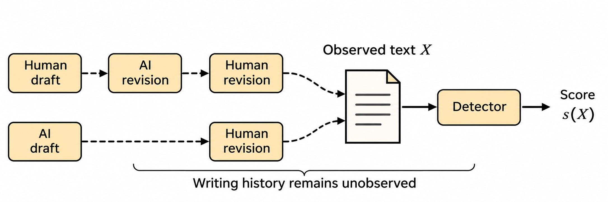
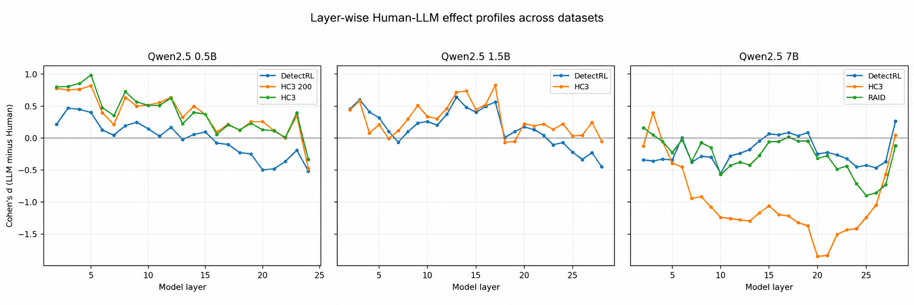
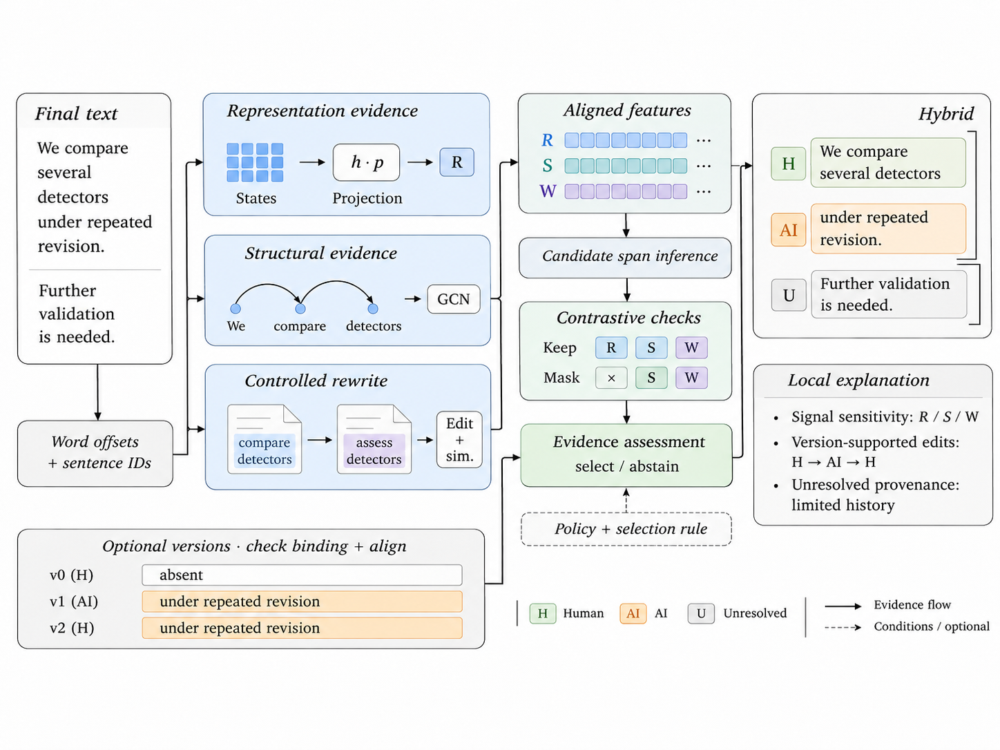

<div align="center">

# Beyond Human vs AI

**A Systematic Survey of Attribution, Robustness, and Human–AI Co-authorship in Large Language Model Forensics**

Pham Quang Toan · Nguyen Duc Trung · Hoang Chi Hien · Nguyen Quang Chien · Nguyen Kieu Linh

Posts and Telecommunications Institute of Technology, Ha Noi, Vietnam<br>
Corresponding author: [Nguyen Kieu Linh](mailto:linhnk@ptit.edu.vn)

[](LICENSE)
[](https://github.com/pitorr05/BeyondHuAI/actions/workflows/validate.yml)

</div>

## Overview

This survey examines how LLM-generated text detection relates to attribution, robustness and human–AI co-authorship. It organizes detection methods by mechanism and development requirements, compares the capabilities evaluated by benchmarks, and connects detector results with representation-level diagnostics. PAAR provides a proposed reference architecture for local contribution assessment and process-supported explanations.

This repository contains the survey's literature resources, data subsets, experimental results and representation-analysis code.

<p align="center">
  
</p>

## Contents

- [Detection methods](#detection-methods)
- [Benchmarks and datasets](#benchmarks-and-datasets)
- [Fine-grained authorship and human–AI collaboration](#fine-grained-authorship)
- [Robustness and attacks](#robustness-and-attacks)
- [Reliability, explanation and verification](#reliability-explanation-and-verification)
- [Related surveys](#related-surveys)
- [Foundations and applications](#foundations-and-applications)
- [Experimental resources](#experimental-resources)
- [Usage](#usage)
- [Citation](#citation)

The tables below list the **82 references cited in the survey**. [The catalog](survey/catalog.csv) records each source's primary role, method family and topics; [the bibliography](survey/references.bib) contains complete citation metadata. Papers with multiple roles have additional topic tags. The literature scope extends through September 2026.

## Detection methods

The three method groups follow Section III. Analysis-model access, development data and reliability evidence are considered across these groups.

### Zero-shot

| Paper | Venue | Year | Resources |
|---|---|---:|---|
| Zero-Shot Detection of LLM-Generated Text using Temperature Sensitivity | ACL | 2026 | [Paper](https://aclanthology.org/2026.acl-long.1748/) |
| Telescope: Improving Zero-Shot Detection of LLM Generated Content By Measuring Token Repetition Probability | arXiv | 2026 | [Paper](https://arxiv.org/abs/2607.04061v1) |
| Exons-Detect: Identifying and Amplifying Exonic Tokens via Hidden-State Discrepancy for Robust AI-Generated Text Detection | ACL | 2026 | [Paper](https://aclanthology.org/2026.acl-long.1211/) |
| Who Wrote This? The Key to Zero-Shot LLM-Generated Text Detection Is GECScore | COLING | 2025 | [Paper](https://aclanthology.org/2025.coling-main.684/) · [Code](https://github.com/NLP2CT/GECScore) |
| DivScore: Zero-Shot Detection of LLM-Generated Text in Specialized Domains | EMNLP | 2025 | [Paper](https://aclanthology.org/2025.emnlp-main.971/) |
| Zero-Shot Detection of LLM-Generated Text using Token Cohesiveness | EMNLP | 2024 | [Paper](https://aclanthology.org/2024.emnlp-main.971/) |
| Spotting LLMs With Binoculars: Zero-Shot Detection of Machine-Generated Text | ICML | 2024 | [Paper](https://proceedings.mlr.press/v235/hans24a.html) · [Code](https://github.com/ahans30/Binoculars) |
| Fast-DetectGPT: Efficient Zero-Shot Detection of Machine-Generated Text via Conditional Probability Curvature | ICLR | 2024 | [Paper](https://openreview.net/forum?id=Bpcgcr8E8Z) · [Code](https://github.com/baoguangsheng/fast-detect-gpt) |
| DNA-GPT: Divergent N-Gram Analysis for Training-Free Detection of GPT-Generated Text | ICLR | 2024 | [Paper](https://openreview.net/forum?id=Xlayxj2fWp) · [Code](https://github.com/Xianjun-Yang/DNA-GPT) |
| DetectLLM: Leveraging Log Rank Information for Zero-Shot Detection of Machine-Generated Text | Findings EMNLP | 2023 | [Paper](https://aclanthology.org/2023.findings-emnlp.827/) |
| DetectGPT: Zero-Shot Machine-Generated Text Detection Using Probability Curvature | ICML | 2023 | [Paper](https://proceedings.mlr.press/v202/mitchell23a.html) · [Code](https://github.com/eric-mitchell/detect-gpt) |

### Training-based

| Paper | Venue | Year | Resources |
|---|---|---:|---|
| WaveDetect: Robust Framework for Machine-Generated Text Detection via Wavelet Transform | Findings ACL | 2026 | [Paper](https://aclanthology.org/2026.findings-acl.424/) |
| StyleDecipher: Robust and Explainable Detection of LLM-Generated Texts with Stylistic Analysis | arXiv | 2025 | [Paper](https://arxiv.org/abs/2510.12608) · [Code](https://github.com/SiyuanLi00/StyleDecipher) |
| SenDetEX: Sentence-Level AI-Generated Text Detection for Human-AI Hybrid Content via Style and Context Fusion | EMNLP | 2025 | [Paper](https://aclanthology.org/2025.emnlp-main.268/) |
| SENTRA: Selected-Next-Token Transformer for LLM Text Detection | Findings EMNLP | 2025 | [Paper](https://aclanthology.org/2025.findings-emnlp.1004/) |
| RepreGuard: Detecting LLM-Generated Text by Revealing Hidden Representation Patterns | TACL | 2025 | [Paper](https://aclanthology.org/2025.tacl-1.81/) · [Code](https://github.com/NLP2CT/RepreGuard) |
| PRDetect: Perturbation-Robust LLM-generated Text Detection Based on Syntax Tree | Findings NAACL | 2025 | [Paper](https://aclanthology.org/2025.findings-naacl.464/) · [Code](https://github.com/thulx18/PRDetect) |
| MoSEs: Uncertainty-Aware AI-Generated Text Detection via Mixture of Stylistics Experts with Conditional Thresholds | EMNLP | 2025 | [Paper](https://aclanthology.org/2025.emnlp-main.294/) |
| Learning to Rewrite: Generalized LLM-Generated Text Detection | ACL | 2025 | [Paper](https://aclanthology.org/2025.acl-long.322/) |
| Text Fluoroscopy: Detecting LLM-Generated Text through Intrinsic Features | EMNLP | 2024 | [Paper](https://aclanthology.org/2024.emnlp-main.885/) |
| Raidar: geneRative AI Detection viA Rewriting | ICLR | 2024 | [Paper](https://openreview.net/forum?id=bQWE2UqXmf) |
| Ghostbuster: Detecting Text Ghostwritten by Large Language Models | NAACL | 2024 | [Paper](https://aclanthology.org/2024.naacl-long.95/) |
| RADAR: Robust AI-Text Detection via Adversarial Learning | NeurIPS | 2023 | [Paper](https://proceedings.neurips.cc/paper_files/paper/2023/hash/30e15e5941ae0cdab7ef58cc8d59a4ca-Abstract-Conference.html) |

### Watermarking

| Paper | Venue | Year | Resources |
|---|---|---:|---|
| A Reinforcement Learning Framework for Robust and Secure LLM Watermarking | EACL | 2026 | [Paper](https://aclanthology.org/2026.eacl-long.338/) |
| StealthInk: A Multi-bit and Stealthy Watermark for Large Language Models | ICML | 2025 | [Paper](https://proceedings.mlr.press/v267/jiang25j.html) |
| Adaptive Text Watermark for Large Language Models | ICML | 2024 | [Paper](https://proceedings.mlr.press/v235/liu24e.html) |
| A Watermark for Large Language Models | ICML | 2023 | [Paper](https://proceedings.mlr.press/v202/kirchenbauer23a.html) · [Code](https://github.com/jwkirchenbauer/lm-watermarking) |

## Benchmarks and datasets

The scale below follows each study’s counting unit. Local subsets and record formats are documented in [data/README.md](data/README.md) and [data/catalog.csv](data/catalog.csv).

| Resource | Venue/year | Generators | Domains | Languages | Reported scale |
|---|---|---:|---:|---:|---|
| [HC3](https://arxiv.org/abs/2301.07597) | arXiv 2023 | 1 | 6 | 2 | ~125k |
| [MGTBench](https://doi.org/10.1145/3658644.3670344) | ACM CCS 2024 | 6 | 3 | 1 | ~21k |
| [M4](https://aclanthology.org/2024.eacl-long.83/) | EACL 2024 | 6 | 7 | 7 | ~147k |
| [M4GT-Bench](https://aclanthology.org/2024.acl-long.218/) | ACL 2024 | 9 | 6 | 9 | ~218k (T1) |
| [MULTITuDE](https://aclanthology.org/2023.emnlp-main.616/) | EMNLP 2023 | 8 | 1 | 11 | 74,081 |
| [MultiSocial](https://aclanthology.org/2025.acl-long.36/) | ACL 2025 | 7 | 1 | 22 | 472k |
| [WETBench](https://aclanthology.org/2025.wikinlp-1.6/) | WikiNLP 2025 | 4 | 1 | 3 | 102k |
| [DivScore](https://aclanthology.org/2025.emnlp-main.971/) | EMNLP 2025 | 4 | 2 | 1 | 4k human refs. |
| [RAID](https://aclanthology.org/2024.acl-long.674/) | ACL 2024 | 11 | 8 | 1 | ~6.2M |
| [Stumbling Blocks](https://aclanthology.org/2024.acl-long.160/) | ACL 2024 | 5 | 1 | 1 | 10k |
| [DetectRL](https://doi.org/10.52202/079017-3186) | NeurIPS 2024 | 4 | 4 | 1 | 235.2K |
| [DetectRL-X](https://aclanthology.org/2026.acl-long.1773/) | ACL 2026 | 4 | 6 | 8 | ~3.46M |
| [MAGE](https://aclanthology.org/2024.acl-long.3/) | ACL 2024 | 27 | 10 | 1 | ~447k |
| [EvoBench](https://aclanthology.org/2025.findings-acl.754/) | Findings ACL 2025 | 29 | 5 | 1 | 43.5k |
| [Beemo](https://aclanthology.org/2025.naacl-long.357/) | NAACL 2025 | 10 | 5 | 1 | 19.6k |
| [HART](https://arxiv.org/abs/2503.00258) | arXiv 2025 | 6 | 4 | 5 | 32k |
| [OpenTuringBench](https://aclanthology.org/2025.emnlp-main.1354/) | EMNLP 2025 | 7 | 1 | 1 | 543k |
| [SeqXGPT](https://aclanthology.org/2023.emnlp-main.73/) | EMNLP 2023 | 5 | 5 | 1 | 30k |
| [HACo-Det](https://aclanthology.org/2025.acl-long.1069/) | ACL 2025 | 4 | 4 | 1 | 11.2k |
| [PASTED](https://aclanthology.org/2024.findings-acl.423/) | Findings ACL 2024 | 2 | 10 | 1 | 83k |
| [GPABench2](https://www.ittc.ku.edu/~bluo/pubs/liu2024checkgpt.pdf) | ACM CCS 2024 | 1 | 3 | 1 | 2.39M |

### Additional benchmark resources

Benchmark implementations: [RAID](https://github.com/liamdugan/raid) · [DetectRL](https://github.com/NLP2CT/DetectRL).

| Paper | Venue | Year | Resources |
|---|---|---:|---|
| Operation-Guided Progressive Human-to-AI Text Transformation Benchmark for Multi-Granularity AI-Text Detection | arXiv | 2026 | [Paper](https://arxiv.org/abs/2606.06481v1) |
| Mark My Words: Analyzing and Evaluating Language Model Watermarks | SaTML | 2025 | [Paper](https://doi.org/10.1109/SaTML64287.2025.00012) |

## Fine-grained authorship

Studies of local predictions, retained contributions and writing operations complement the document-level methods listed above.

| Paper | Venue | Year | Resources |
|---|---|---:|---|
| SenFlow: Inter-Sentence Flow Modeling for AI-Generated Text Detection in Hybrid Documents | arXiv | 2026 | [Paper](https://arxiv.org/abs/2606.18946v1) |
| Detecting LLM-Generated Tokens in Human–LLM Coauthored Text | arXiv | 2026 | [Paper](https://arxiv.org/abs/2607.21458v1) |
| CoCoNUTS: Concentrating on Content while Neglecting Uninformative Textual Styles for AI-Generated Peer Review Detection | ACL | 2026 | [Paper](https://aclanthology.org/2026.acl-long.1240/) |
| Spotting AI's Touch: Identifying LLM-Paraphrased Spans in Text | Findings ACL | 2024 | [Paper](https://aclanthology.org/2024.findings-acl.423/) |
| LLM-as-a-Coauthor: Can Mixed Human-Written and Machine-Generated Text Be Detected? | Findings NAACL | 2024 | [Paper](https://aclanthology.org/2024.findings-naacl.29/) |
| SeqXGPT: Sentence-Level AI-Generated Text Detection | EMNLP | 2023 | [Paper](https://aclanthology.org/2023.emnlp-main.73/) |

## Robustness and attacks

| Paper | Venue | Year | Resources |
|---|---|---:|---|
| Revealing Weaknesses in Text Watermarking Through Self-Information Rewrite Attacks | ICML | 2025 | [Paper](https://proceedings.mlr.press/v267/cheng25c.html) |
| Stumbling Blocks: Stress Testing the Robustness of Machine-Generated Text Detectors Under Attacks | ACL | 2024 | [Paper](https://aclanthology.org/2024.acl-long.160/) |
| Paraphrasing Evades Detectors of AI-Generated Text, But Retrieval is an Effective Defense | NeurIPS | 2023 | [Paper](https://proceedings.neurips.cc/paper_files/paper/2023/hash/575c450013d0e99e4b0ecf82bd1afaa4-Abstract-Conference.html) |

## Reliability, explanation and verification

| Paper | Venue | Year | Resources |
|---|---|---:|---|
| Show, Don't TELL: Explainable AI-Generated Text Detection | arXiv | 2026 | [Paper](https://arxiv.org/abs/2605.27921v1) |
| ExaGPT: Example-Based Machine-Generated Text Detection for Human Interpretability | Findings ACL | 2026 | [Paper](https://aclanthology.org/2026.findings-acl.380/) |
| Who Writes What: Unveiling the Impact of Author Roles on AI-generated Text Detection | ACL | 2025 | [Paper](https://aclanthology.org/2025.acl-long.1292/) |
| The Two Paradigms of LLM Detection: Authorship Attribution vs. Authorship Verification | Findings ACL | 2025 | [Paper](https://aclanthology.org/2025.findings-acl.194/) |
| Reliably Bounding False Positives: A Zero-Shot Machine-Generated Text Detection Framework via Multiscaled Conformal Prediction | ACL | 2025 | [Paper](https://aclanthology.org/2025.acl-long.601/) |
| GPT Detectors are Biased Against Non-Native English Writers | Patterns | 2023 | [Paper](https://doi.org/10.1016/j.patter.2023.100779) |
| Can AI-Generated Text Be Reliably Detected? | arXiv | 2023 | [Paper](https://arxiv.org/abs/2303.11156) |

## Related surveys

| Paper | Venue | Year | Resources |
|---|---|---:|---|
| What Distinguishes AI-Generated from Human Writing? A Rapid Review of the Literature | Big Data and Cognitive Computing | 2026 | [Paper](https://doi.org/10.3390/bdcc10020055) |
| Human or Machine? A Survey on Machine-Generated Text Detection | IEEE Access | 2026 | [Paper](https://doi.org/10.1109/ACCESS.2026.3666781) |
| The Imitation Game revisited: A comprehensive survey on recent advances in AI-generated text detection | ESWA | 2025 | [Paper](https://www.sciencedirect.com/science/article/pii/S0957417425003161) |
| AI-generated text detection: A comprehensive review of methods, datasets, and applications | Computer Science Review | 2025 | [Paper](https://www.sciencedirect.com/science/article/pii/S1574013725000693) |
| A Survey on LLM-Generated Text Detection: Necessity, Methods, and Future Directions | Computational Linguistics | 2025 | [Paper](https://aclanthology.org/2025.cl-1.8/) |
| A Survey of Text Watermarking in the Era of Large Language Models | ACM CSUR | 2025 | [Paper](https://doi.org/10.1145/3691626) |
| A Survey of AI-Generated Content (AIGC) | ACM CSUR | 2025 | [Paper](https://doi.org/10.1145/3704262) |
| A Comprehensive Survey of Fake Text Detection on Misinformation and LM-Generated Texts | IEEE Access | 2025 | [Paper](https://doi.org/10.1109/ACCESS.2025.3538805) |
| A Survey on Detection of LLMs-Generated Content | Findings EMNLP | 2024 | [Paper](https://aclanthology.org/2024.findings-emnlp.572/) |
| A Survey of AI-generated Text Forensic Systems: Detection, Attribution, and Characterization | arXiv | 2024 | [Paper](https://arxiv.org/abs/2403.01152) |

## Foundations and applications

<details>
<summary>Model reports, applications and contextual studies</summary>

| Paper | Venue | Year | Resources |
|---|---|---:|---|
| The Role of Generative AI ChatGPT Technology in Renewing Journalism: A Systematic Review | Journal of Mass Communication Research | 2025 | [BibTeX](survey/references.bib) |
| Qwen2.5 Technical Report | arXiv | 2025 | [Paper](https://arxiv.org/abs/2412.15115v2) |
| LLMs for Science: Usage for Code Generation and Data Analysis | Journal of Software: Evolution and Process | 2025 | [Paper](https://doi.org/10.1002/smr.2723) |
| The Role of ChatGPT in Medical Research: Progress and Limitations | Annals of Biomedical Engineering | 2024 | [Paper](https://doi.org/10.1007/s10439-023-03311-0) |
| ChatGPT in Medicine: Prospects and Challenges: A Review Article | International Journal of Surgery | 2024 | [Paper](https://doi.org/10.1097/JS9.0000000000001312) |
| Regulating ChatGPT and Other Large Generative AI Models | ACM FAccT | 2023 | [Paper](https://doi.org/10.1145/3593013.3594067) |
| LLaMA: Open and Efficient Foundation Language Models | arXiv | 2023 | [Paper](https://arxiv.org/abs/2302.13971) |
| GPT-4 Technical Report | arXiv | 2023 | [Paper](https://arxiv.org/abs/2303.08774) |
| Experimental Evidence on the Productivity Effects of Generative Artificial Intelligence | Science | 2023 | [Paper](https://doi.org/10.1126/science.adh2586) |
| On the Opportunities and Risks of Foundation Models | arXiv | 2021 | [Paper](https://arxiv.org/abs/2108.07258) |

</details>

## Experimental resources

| Analysis | Released material | Documentation |
|---|---|---|
| Detector comparison on HC3 and DetectRL | [Five-detector results](results/detectors/five-detector-comparison.csv) | [Detector experiments](docs/experiments.md#detector-experiments) |
| Cross-benchmark ranking and decisions | [PRDetect and representation-based results](results/detectors/cross-benchmark-comparison.csv) | [Evaluation protocols](docs/experiments.md#detector-experiments) |
| Representation diagnostics | [Eight run configurations](results/representation/run_catalog.csv), [204 layer records](results/representation/summaries/Table_S1_All_Layer_Effects.csv), [42,840 layer–position records](results/representation/summaries/Table_S2_All_Token_Layer_Effects.csv) | [Representation analysis](docs/experiments.md#representation-analysis) |
| Figures | [Gallery](docs/figure-gallery.md), [source assets](assets/paper/) | [Figure manifest](assets/manifest.json) |

Detector experiments use the original implementations with the data and model configurations described in the survey. This repository provides their result tables and the code for the separate representation analysis.

<p align="center">
  
</p>

The diagnostics examine contrast magnitude, token-position concentration and cross-dataset profile alignment. Their interpretation and sampling protocol are described in [the experimental guide](docs/experiments.md).

<details>
<summary>PAAR: proposed reference architecture</summary>

PAAR links representation, structural and rewrite-response evidence to local contribution claims, contrastive checks and available version records. Its integrated evaluation is a future research direction.



</details>

## Usage

Rebuild the representation tables and diagnostic plots from the released CSVs on CPU with Python 3.11 or newer:

```bash
python -m pip install -r requirements-analysis.txt
python -m analysis.insight rebuild
```

Results are written to `outputs/rebuilt/`. Use a different empty output directory for additional runs:

```bash
python -m analysis.insight rebuild --tables-only --output-dir outputs/tables
python -m analysis.insight extract --help
```

See [the experimental guide](docs/experiments.md#hidden-state-extraction) for hidden-state extraction, model requirements and input data.

## Citation

```bibtex
@misc{pham2026beyondhuai,
  title  = {Beyond Human vs AI: A Systematic Survey of Attribution, Robustness,
            and Human--AI Co-authorship in Large Language Model Forensics},
  author = {Pham, Quang Toan and Nguyen, Duc Trung and Hoang, Chi Hien
            and Nguyen, Quang Chien and Nguyen, Kieu Linh},
  year   = {2026},
  note   = {Research manuscript},
  url    = {https://github.com/pitorr05/BeyondHuAI}
}
```

[CITATION.cff](CITATION.cff) provides the software citation.

## License and contributions

Original code and repository documentation are available under [MIT](LICENSE). Dataset texts retain their upstream terms and attribution. Manuscript figures remain author-supplied research artwork; the code license grants no separate image-reuse license. The external RepreGuard loader is obtained under its own terms.

For reference corrections or resource additions, please open an issue or pull request with the relevant source link. Cite the original methods and datasets when using their resources.
