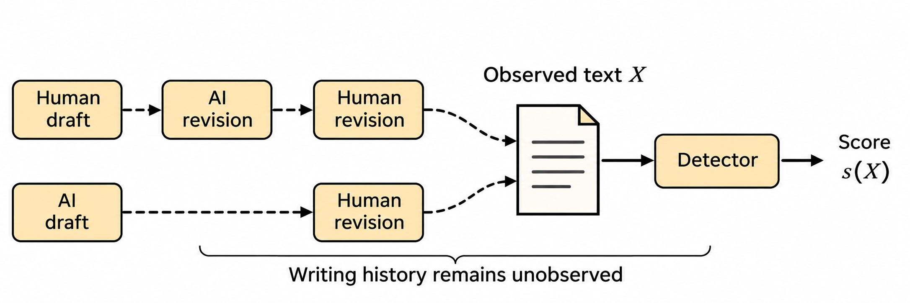
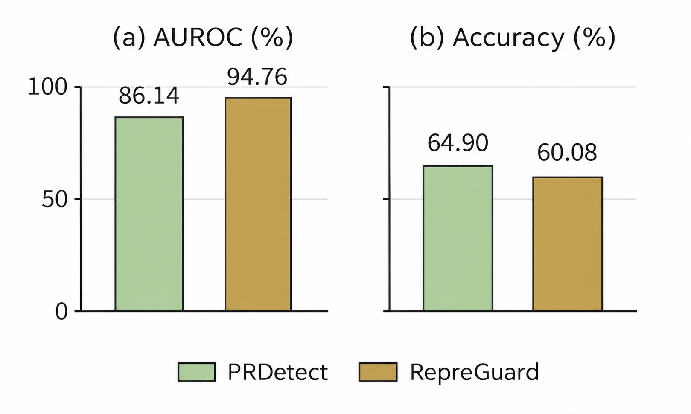
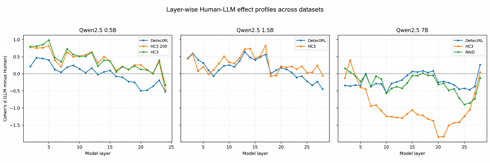
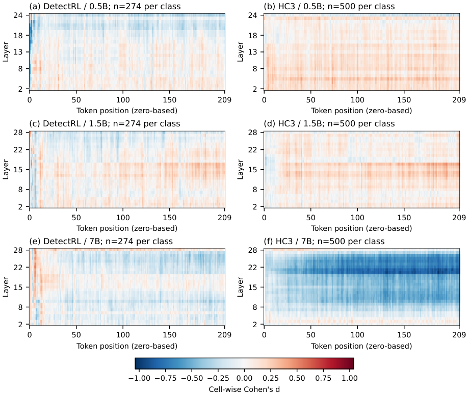
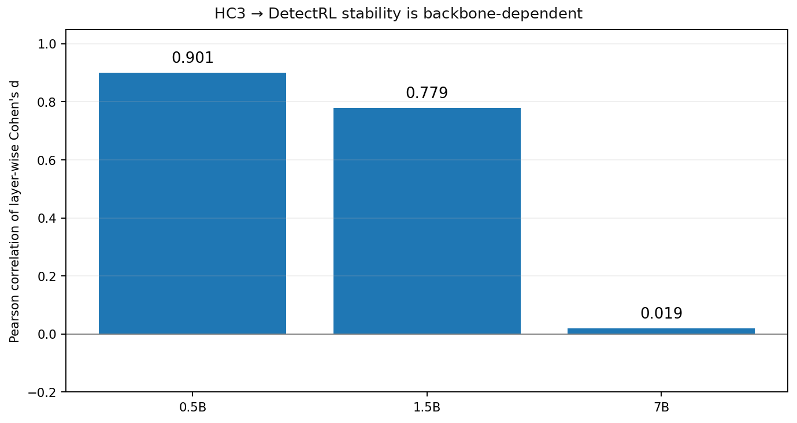
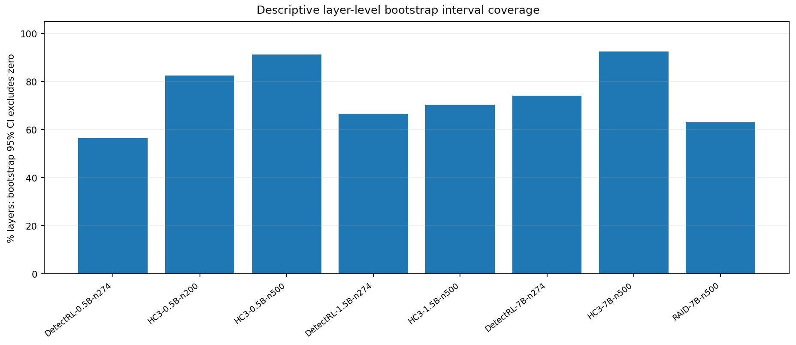
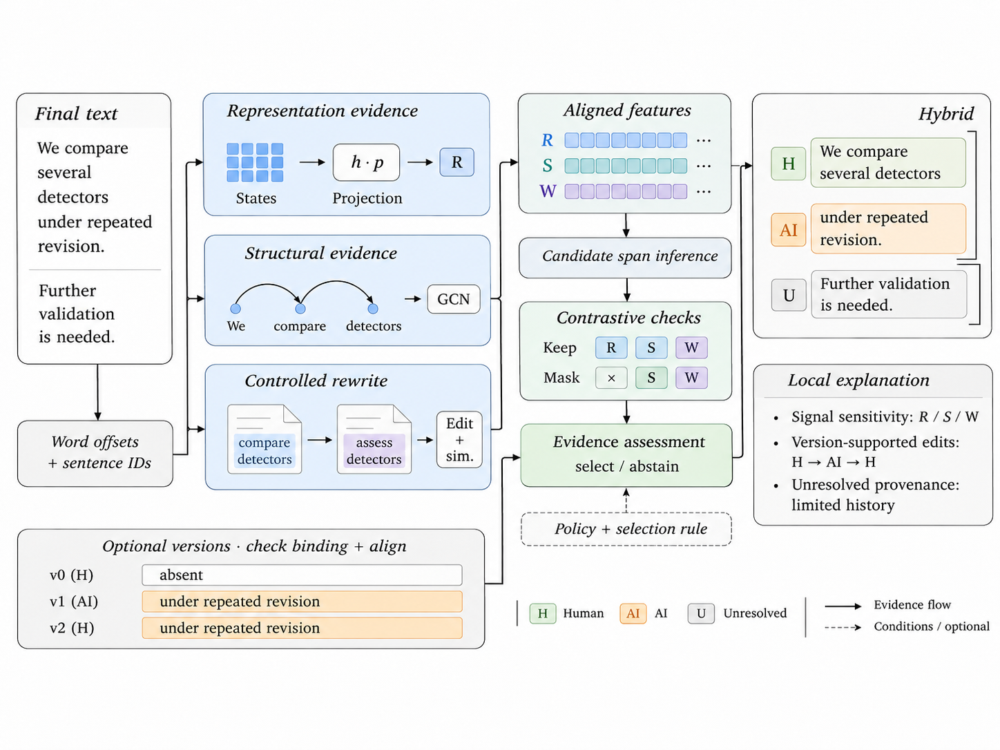
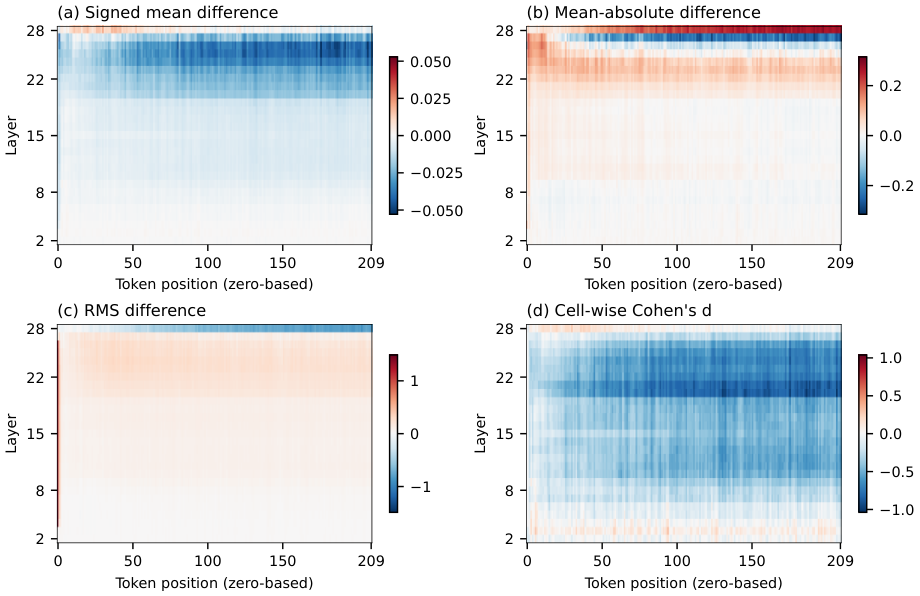
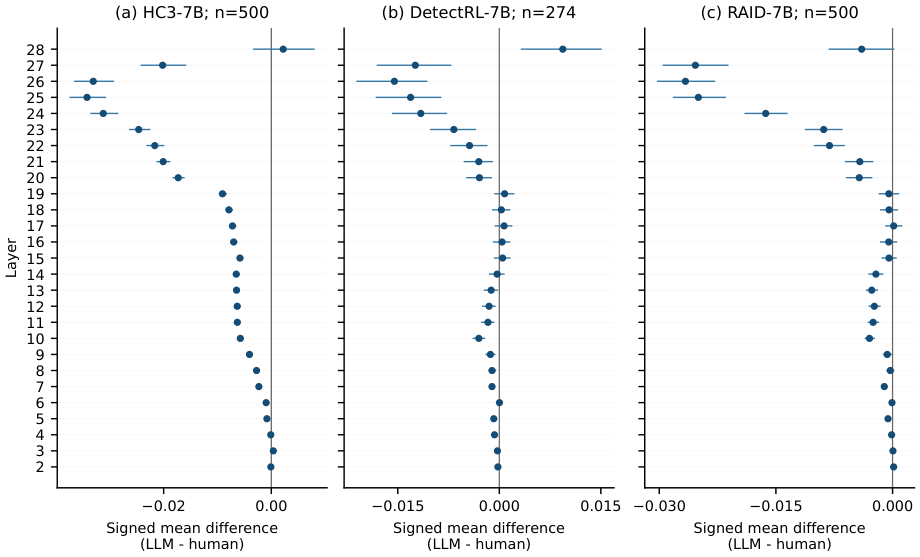

# Manuscript figures

Figures from the survey, with original assets and separate PNG previews for PDF figures.

## Figure 1: Alternative writing histories and the limits of document-level detection

[Original asset](../assets/paper/motivation_authorship_evidence.png)

## Figure 2: Ranking–decision divergence on GPT-3.5 mixed

[Original asset](../assets/paper/motivation_ranking_decisions.png)

## Figure 3: Layer-wise effect profiles

[Original asset](../assets/paper/Figure_A_Layer_Effect_Profiles.png)

## Figure 4: Cell-wise standardized contrasts

[Original asset](../assets/paper/diagnostic_cell_contrasts.pdf)

## Figure 5: Cross-dataset profile alignment

[Original asset](../assets/paper/Figure_B_Cross_Dataset_Stability.png)

## Figure 6: Unadjusted bootstrap-interval coverage

[Original asset](../assets/paper/Figure_C_Layer_CI_Coverage.png)

## Figure 7: Proposed PAAR reference architecture

[Original asset](../assets/paper/paar_framework.png)

## Figure 8: Complementary signed and magnitude contrasts

[Original asset](../assets/paper/diagnostic_complete_hc3_7b.pdf)

## Figure 9: Layer-wise signed differences and intervals

[Original asset](../assets/paper/diagnostic_layer_intervals_7b.pdf)

