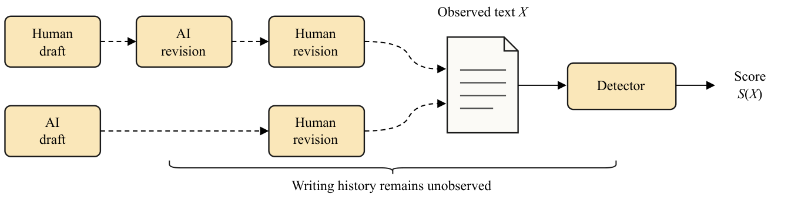
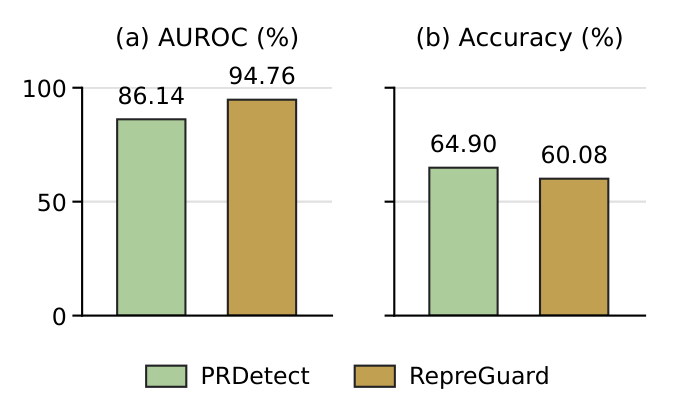
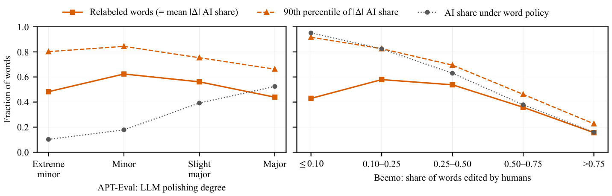
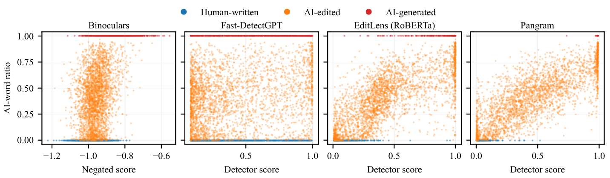
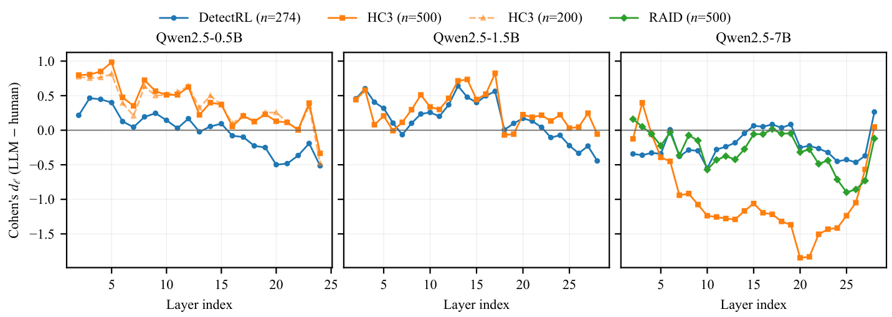
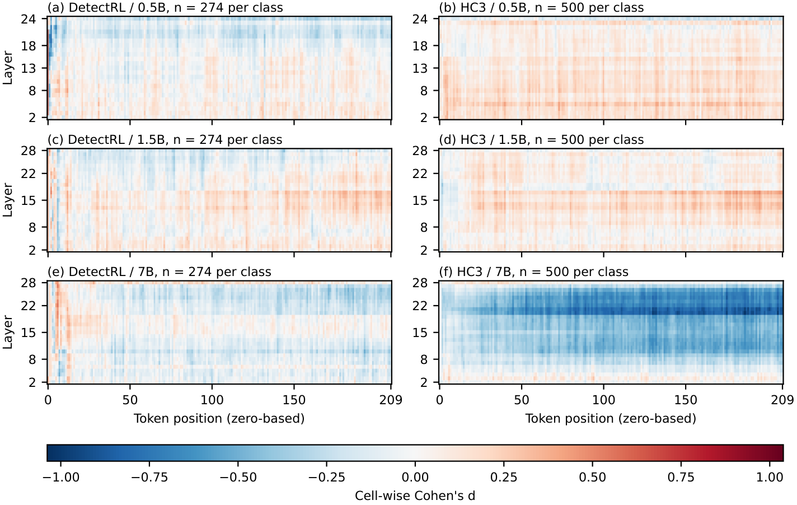
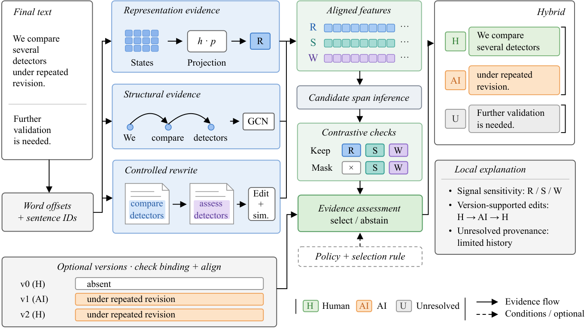
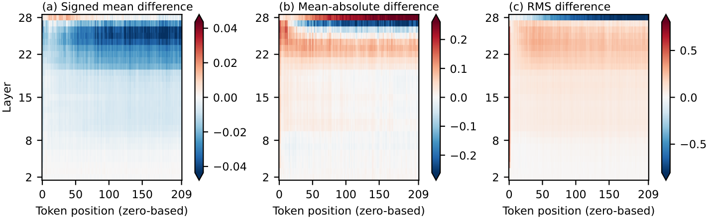
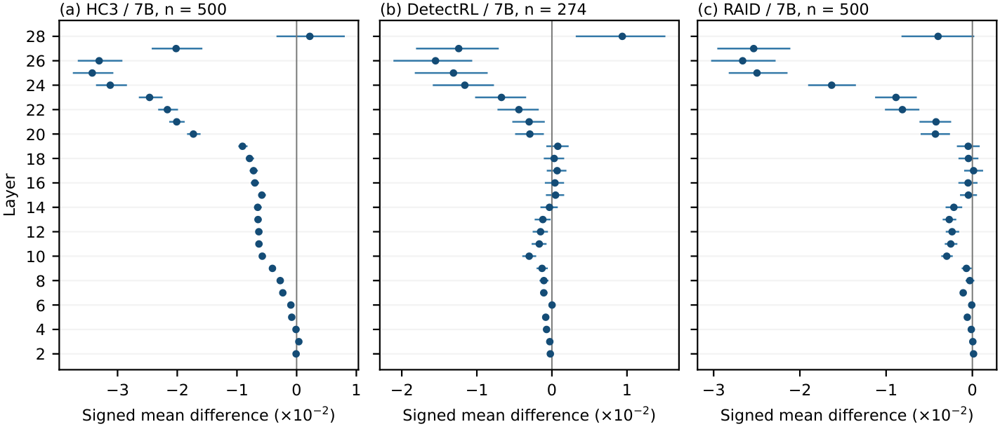

# Manuscript figures

All nine figures of the survey, in manuscript order. PDF figures are shown through PNG previews rendered at 200 dpi; the vector originals are in [assets/paper](../assets/paper/).

## Figure 1. Alternative writing histories leading to an observed text

A document-level detector evaluates the final artifact; several sequences of human and AI operations can produce the same text.

## Figure 2. Ranking–decision divergence on GPT-3.5 mixed

RepreGuard attains the higher AUROC (94.76% vs. 86.14%) but the lower accuracy (60.08% vs. 64.90%) when both decision rules are fixed on HC3.

## Figure 3. Word-level versus sentence-level attribution policies

Share of relabeled words on APT-Eval by LLM polishing degree and on Beemo by share of human-edited words.

## Figure 4. Detector score versus word-level AI ratio

8,515 EditLens documents; scores released with the corpus for Binoculars, Fast-DetectGPT, EditLens and Pangram.

## Figure 5. Layer-wise effect profiles

Cohen's d for document-pooled signed activations across HC3, DetectRL and RAID with Qwen2.5 0.5B, 1.5B and 7B backbones.

## Figure 6. Cell-wise standardized contrasts

Layer–position maps of d for DetectRL and HC3 with three backbones, on one symmetric scale.

## Figure 7. PAAR reference architecture

Process-Aware Authorship Reconstruction: word-aligned representation, structural and rewrite evidence, candidate span inference, contrastive checks, version records and claim assessment.

## Figure 8. Complementary activation contrasts for HC3/7B

Signed mean, mean-absolute and RMS differences, LLM minus human (Appendix A).

## Figure 9. Layer-wise mean differences and 95% bootstrap intervals

The three 7B configurations (Appendix A).

